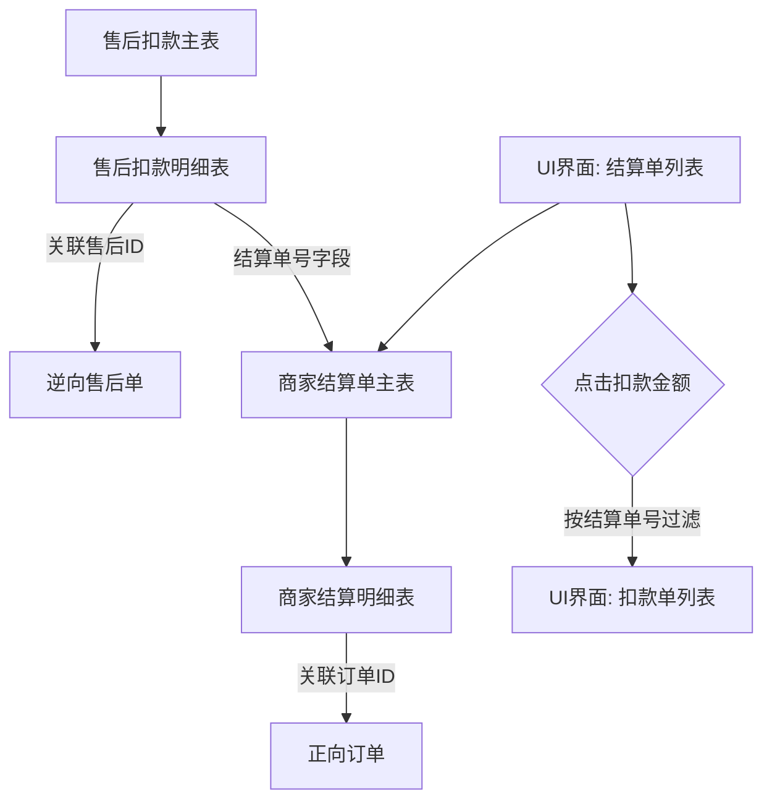

这是一个非常关键且实操性很强的问题。从**产品体验**和**财务对账**两个维度来看，**建议分开，但需要强关联**。

为什么建议分开？因为这两张单据的**阅读对象**和**业务目的**完全不同：

1.  **结算单**：是给商家看的“收入账单”，展示“我赚了多少钱”。
2.  **扣款单**：是给商家看的“支出账单”，展示“我被扣了多少钱”（或者财务审计时看“钱去哪了”）。

如果把两者混在一个页面，不仅逻辑复杂，而且容易引起商家的困惑和投诉。以下是具体的分页设计和管理方案：

---

### 方案一：双页面独立展示（推荐）
这是主流电商平台（如抖音小店、淘宝卖家中心）的做法。

#### 页面1：商家结算单列表
-   **核心作用：** 确认收入、发起提现、查看打款进度。
-   **展示内容：**
    -   **结算单号**、**结算周期**（如：2026-03-01 ~ 2026-03-07）。
    -   **应收总额**：本期所有订单金额。
    -   **扣款总额**：本期抵扣的售后总额（点击可跳转查看明细）。
    -   **实付金额**：最终打入银行卡的金额。
    -   **状态**：待结算、结算中、已到账。
-   **交互细节：**
    -   在扣款总额那里加一个蓝色的数字链接，弹窗或跳转到**扣款单列表**，并自动筛选出“关联本结算单”的扣款记录。

#### 页面2：售后扣款单列表
-   **核心作用：** 对账、申诉、查看每一笔退款的处理进度。
-   **展示内容：**
    -   **关联原订单号**、**售后单号**、**退款金额**。
    -   **扣款状态**：待扣除、已扣除（并展示在结算单号A中扣除）、已驳回。
    -   **关联结算单号**：这一列很重要，用来连接两个页面。
-   **交互细节：**
    -   支持通过“关联结算单号”进行搜索，方便财务人员核对某一期账单里到底有哪些退款。

#### 为什么要这样做？
-   **对商家友好：** 商家最关心的是“我最终拿到多少钱”。如果扣款和收入混在一个复杂的表格里，他们容易看不懂。分开后，结算单页面非常清爽，只展示“进账”。
-   **对财务/客服友好：** 当商家质问“为什么这期钱少了”时，客服可以直接在扣款单页面搜索时间范围，快速列出所有扣款原因（退款、违约金等），截图发给商家，处理效率更高。

---

### 方案二：主明细合并在一个页面（进阶版）
如果你的系统体量较小，或者希望页面更精简，可以只做一个页面，但必须用层级结构区分开。

#### 设计形式：结算单详情页（主表 + 子表）
-   **主表区域（头部）：** 展示结算单汇总信息（应收、实付、状态）。
-   **子表区域（明细 - Tab切换）：**
    -   **Tab 1：收入明细**（订单列表）：展示本期哪些订单贡献了收入。
    -   **Tab 2：扣款明细**（售后/罚单列表）：展示本期抵扣了哪些售后退款或平台罚金。
    -   **Tab 3：收支汇总**（流水账）：按时间顺序混合展示收入和支出，类似于银行流水。

#### 这样做的好处：
-   **上下文清晰：** 商家在同一个页面内就能看到“我因为A订单赚了钱，又因为B订单退了款”，逻辑一目了然，无需来回跳转。
-   **开发成本低：** 只有一个数据源，后端接口容易维护。

---

### 关键数据关联设计
无论采用哪种页面方案，数据库表之间的关联关系是核心，建议如下：

**关键字段说明：**
-   **售后扣款单表** 中必须有一个字段：`settlement_id`（关联的结算单ID）。
-   当结算单生成并抵扣了售后款后，要将对应的售后扣款单状态更新为“已结算”，并填上这个`settlement_id`。

### 最终建议
1.  **如果预算和时间充足，建议采用“方案一（双页面独立展示）+ 方案二（详情页Tab切换）”的组合。**
    -   列表页分开，让商家快速筛选“收入”或“支出”。
    -   详情页合并，让商家核对“一笔账”的来龙去脉。
2.  **命名要谨慎：**
    -   不要叫“扣款单”，这个词容易让商家产生抵触情绪（听起来像罚款）。
    -   **建议改名为：** **“售后抵扣明细”** 或 **“退款账单”**。这样既准确，又显得合情合理（因为用户退货了，所以扣钱）。

**总结一句话：** 分页是为了**管理效率**，关联是为了**数据闭环**。只要在两个页面之间做好跳转链接（通过结算单号关联），分页并不会增加使用负担，反而会让系统看起来更专业。
